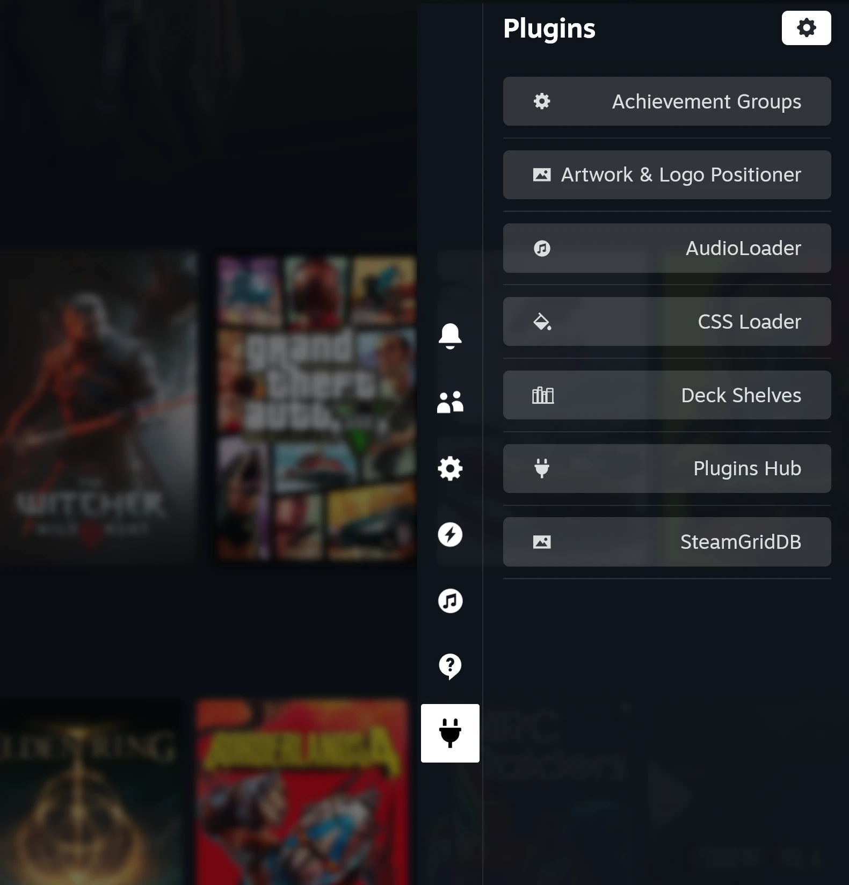

<div align="center">


[](LICENSE) 
</div>

<h1 align="center"> Plugins Hub for Millennium </h1>

One plug tab in Steam Big Picture's Quick Access menu with the panels of all your [Millennium](https://steambrew.app) plugins, plus a setting for the tab game pages open on.

## Usage
Open Quick Access in Big Picture and select the plug tab. Pick a plugin from the list to open its panel, and go back with the arrow or B. The gear button opens Millennium's settings.

Open **Plugins Hub** in the list to choose the tab game pages open on: Steam Default, Activity, Your Stuff, Community or Game Info.

## Features
- The tab is part of Steam's own Quick Access menu from its first render.
- Lists every Millennium plugin with a panel as soon as it loads, including its title buttons.
- Panels fit the Quick Access width, and dropdown menus stay fully on screen.
- Game pages open straight on your chosen tab; tabs you pick yourself stay as they are.

## Installation
1. Install [Millennium](https://steambrew.app)
2. Download the latest release from [Releases](https://github.com/DevsNate/PluginsHub-Millennium/releases)
3. Copy `plugins-hub.star` into `Steam/millennium/plugins` (requires a Starlight-capable Millennium, verified with v3.6.2)
4. Restart Steam and enable Plugins Hub in Millennium's plugin settings

### For plugin authors
Any plugin that returns `content` and `icon` from `definePlugin` appears in the hub; nothing else is needed.

## Building
```bash
pnpm install
pnpm run build
```
The package is written to `dist/plugins-hub.star`; building does not install it
or restart Steam. A plain `starlight pack -o dist` (with `dist/` already created)
also builds it with no install, which is how Millennium's plugin database builds
plugins.

| Command | What it does |
|---|---|
| `pnpm dev` | Rebuilds on change |
| `pnpm check` | Runs every check in `scripts/checks/`; build first. The serve-patch check applies the patches to the installed Steam client's `sp.js` (set `STEAM_PATH` if it isn't in the default folder) and skips without one |

## Project layout
```
backend/main.lua          Lua backend: the patches applied to Steam's sp.js as it's served
frontend/
  index.tsx               Entry point: the hub's list, panels and settings
  registry.ts             Watches Millennium's panel registry
  game-tab.ts             The saved default game page tab
  icons.tsx               Inline icons
scripts/                  checks/ and the script that runs them
```

# Credits
**Panel layout:** adapted from [Decky Loader](https://github.com/SteamDeckHomebrew/decky-loader)  
**Icons:** Font Awesome Free (CC BY 4.0) and Bootstrap Icons (MIT)  
**Author:** [DevsNate](https://github.com/DevsNate)

# License
[GPL-2.0-only](LICENSE), the same as Decky Loader.
